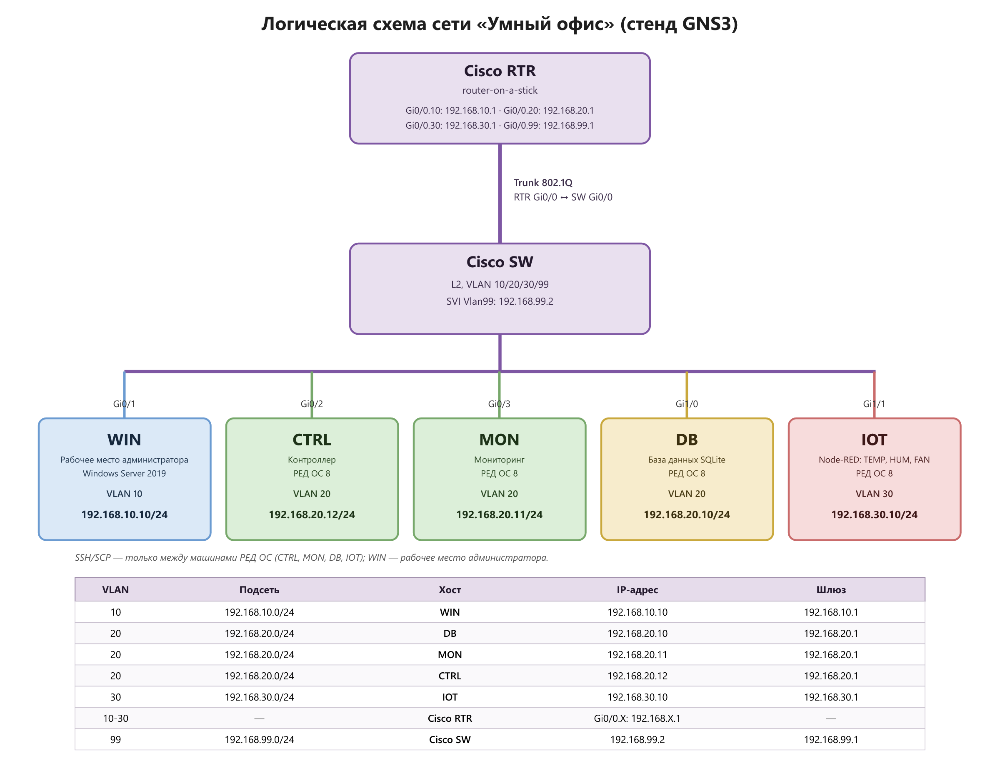
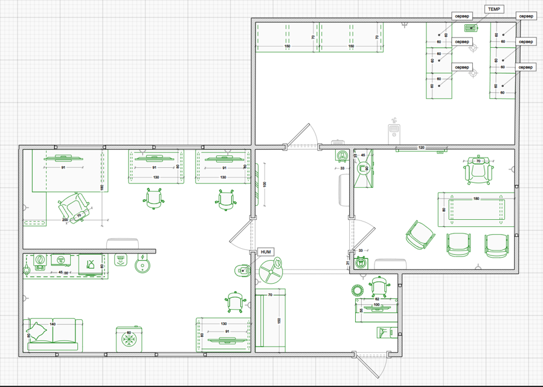
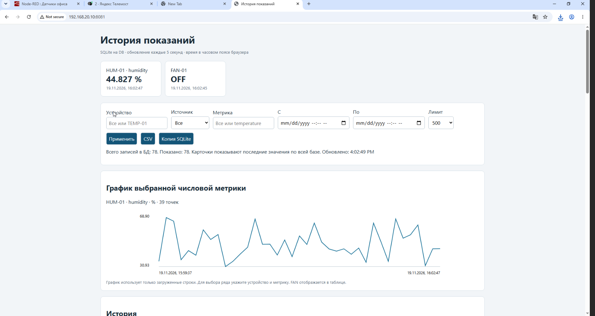
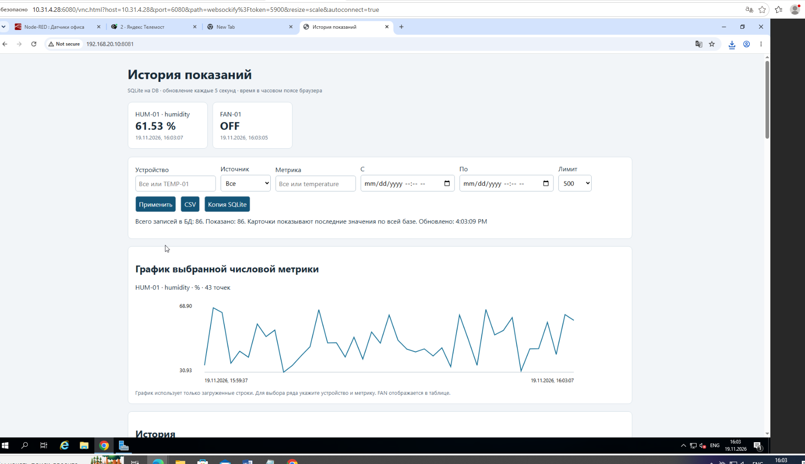
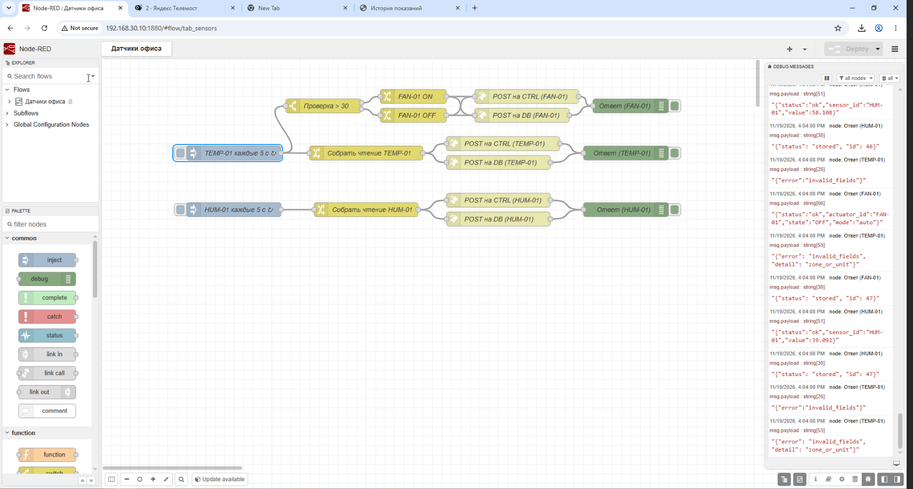
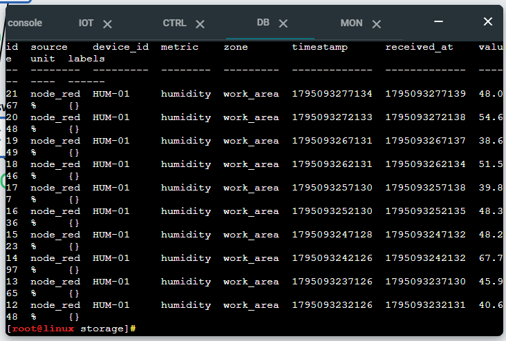
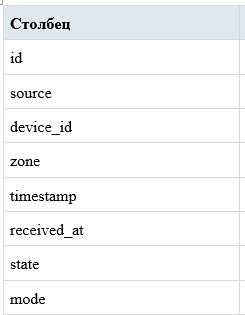

# Умный офис

Учебный проект по созданию виртуальной системы мониторинга и автоматизации офисного помещения.

**Дисциплина:** МДК 03.01. Разработка приложений взаимодействия с интеллектуальными интегрированными системами  
**Специальность:** 09.02.08 Интеллектуальные интегрированные системы  
**Группа:** 54-15  
**Практическая работа:** №6 — интеграция базы данных SQLite

## О проекте

Цель проекта — разработать прототип умного офиса, который отслеживает температуру и влажность, автоматически управляет вентиляцией серверной и сохраняет историю показаний.

Стенд собран в GNS3 на виртуальных машинах РЕД ОС 8 и Windows Server 2019. В практической работе №6 в систему добавлена база данных SQLite на виртуальной машине DB: показания датчиков и события вентилятора теперь не только принимаются контроллером CTRL, но и сохраняются в базе.

## Состав системы

| Устройство | Назначение |
|---|---|
| WIN | Рабочее место администратора, Windows Server 2019 |
| IOT | Эмуляция датчиков и вентилятора в Node-RED |
| CTRL | Приём показаний и предоставление метрик |
| DB | Хранение истории показаний в SQLite, веб-интерфейс истории |
| MON | Мониторинг через Prometheus и Grafana |
| RTR | Маршрутизация между VLAN и выход в интернет |
| SW | Подключение устройств и разделение сети на VLAN |

## Сеть стенда





### Адресация хостов

| Устройство | VLAN | IP-адрес | Шлюз |
|---|---|---|---|
| WIN | 10 | `192.168.10.10/24` | `192.168.10.1` |
| DB | 20 | `192.168.20.10/24` | `192.168.20.1` |
| MON | 20 | `192.168.20.11/24` | `192.168.20.1` |
| CTRL | 20 | `192.168.20.12/24` | `192.168.20.1` |
| IOT | 30 | `192.168.30.10/24` | `192.168.30.1` |
| Cisco RTR | 10–30 | `Gi0/0.X: 192.168.X.1` | — |
| Cisco SW | 99 | `192.168.99.2/24` | `192.168.99.1` |

### Веб-интерфейсы

| Сервис | Адрес |
|---|---|
| Node-RED на IOT | `http://192.168.30.10:1880` |
| Приёмник CTRL | `http://192.168.20.12:8080` |
| История показаний на DB | `http://192.168.20.10:8081` |

## Принцип работы

На IOT в Node-RED созданы виртуальные устройства:

- **TEMP-01** — датчик температуры серверной;
- **HUM-01** — датчик влажности рабочей зоны;
- **FAN-01** — имитация вентилятора.

Датчики отправляют показания каждые 5 секунд. Состояние вентилятора определяется температурой через условие в Node-RED: при превышении порога формируется команда `ON`, иначе `OFF`.

Каждое сообщение датчика и каждое событие вентилятора отправляются параллельно на два адреса: в приёмник CTRL и в сервис хранения на DB. Сервис на DB записывает данные в SQLite и показывает их в веб-интерфейсе. Prometheus собирает метрики с CTRL, а Grafana отображает их на панели мониторинга.

## Практическая работа №6. Интеграция SQLite

### Что сделано

1. На ВМ DB установлены `docker`, `docker compose` и `sqlite3`.
2. Создана база данных `data/telemetry.sqlite3` с таблицами `measurements` и `actuator_events`.
3. В каталог `sources/practice-6` перенесены раздаточные файлы: `compose.yml`, `server.py`, `index.html`, `inspect_db.py`.
4. Сервис `storage` запущен через Docker Compose на порту `8081`.
5. В Node-RED добавлены узлы `POST на CTRL` и `POST на DB` для TEMP-01, HUM-01 и FAN-01 — сообщения уходят на оба сервиса параллельно.
6. Проверена запись показаний и событий в SQLite, а также их отображение в веб-интерфейсе.

### Схема базы данных

Таблица `measurements` хранит показания датчиков:

```sql
CREATE TABLE measurements (
  id INTEGER PRIMARY KEY,
  source TEXT NOT NULL,
  device_id TEXT NOT NULL,
  metric TEXT NOT NULL,
  zone TEXT NOT NULL,
  timestamp INTEGER NOT NULL,
  received_at INTEGER NOT NULL,
  value REAL NOT NULL,
  unit TEXT NOT NULL,
  labels TEXT NOT NULL DEFAULT '{}'
);
```

Таблица `actuator_events` хранит события вентилятора:

```sql
CREATE TABLE actuator_events (
  id INTEGER PRIMARY KEY,
  source TEXT NOT NULL,
  device_id TEXT NOT NULL,
  zone TEXT NOT NULL,
  timestamp INTEGER NOT NULL,
  received_at INTEGER NOT NULL,
  state TEXT NOT NULL,
  mode TEXT NOT NULL
);
```

Полный скрипт создания базы находится в [`sources/practice-6/init.sql`](sources/practice-6/init.sql).

### Запуск сервиса хранения

На ВМ DB files находятся в одной папке, рядом с ними — подпапка `data` с готовой базой:

```text
practice-6/
├── compose.yml
├── server.py
├── index.html
├── inspect_db.py
└── data/
    └── telemetry.sqlite3
```

База создаётся один раз до запуска контейнера:

```bash
cd practice-6
sqlite3 data/telemetry.sqlite3 < init.sql
docker compose up -d
docker compose ps
curl http://127.0.0.1:8081/health
```

Контейнер `storage` публикует порт `8081` и перезапускается автоматически (`restart: unless-stopped`). Сервис не создаёт таблицы сам: при старте он проверяет существующую схему и завершается с ошибкой, если база или таблицы отсутствуют.

## Результаты проверки

Веб-интерфейс истории показаний на DB: видны последние значения HUM-01 и FAN-01, общее число записей и график влажности.





Поток Node-RED: показания каждого датчика и состояние вентилятора отправляются и на CTRL, и на DB.



Проверка записей в SQLite через `sqlite3`:



Структура таблицы `actuator_events`:



SQL-запросы для проверки:

```sql
-- Последние показания датчиков
SELECT id, device_id, metric, value, unit,
       datetime(timestamp / 1000, 'unixepoch') AS ts
FROM measurements
ORDER BY id DESC
LIMIT 10;

-- Последние события вентилятора
SELECT id, device_id, state, mode,
       datetime(timestamp / 1000, 'unixepoch') AS ts
FROM actuator_events
ORDER BY id DESC
LIMIT 10;

-- Количество записей в каждой таблице
SELECT 'measurements' AS table_name, COUNT(*) AS rows FROM measurements
UNION ALL
SELECT 'actuator_events', COUNT(*) FROM actuator_events;
```

## Используемые технологии

- **GNS3** — моделирование компьютерной сети;
- **РЕД ОС 8** — операционная система серверов;
- **Docker Compose** — запуск контейнерных приложений;
- **Node-RED** — моделирование датчиков и управление вентилятором;
- **SQLite** — хранение истории показаний и событий;
- **Python** — сервис хранения и веб-интерфейс;
- **Prometheus и Grafana** — сбор метрик и визуализация;
- **GitHub** — хранение исходников, конфигураций и документации.

## Структура репозитория

```text
smart-office/
├── README.md                  — описание проекта и результатов работы
├── journal.md                 — журнал выполненных работ
├── docs/
│   ├── task_1/                — схема сети и план офиса
│   └── task_6/                — скриншоты выполненной работы №6
├── sources/
│   └── practice-6/            — конфигурация и исходники сервиса хранения
└── deliverables/
    └── Отчет_6_SQLite.docx    — отчёт по практической работе
```

## Результат

В ходе практической работы №6 в проект добавлена база данных SQLite. Показания TEMP-01 и HUM-01, а также состояния FAN-01 параллельно поступают на CTRL и сохраняются на DB. История доступна в веб-интерфейсе и проверена SQL-запросами; структура таблиц соответствует заданию.
